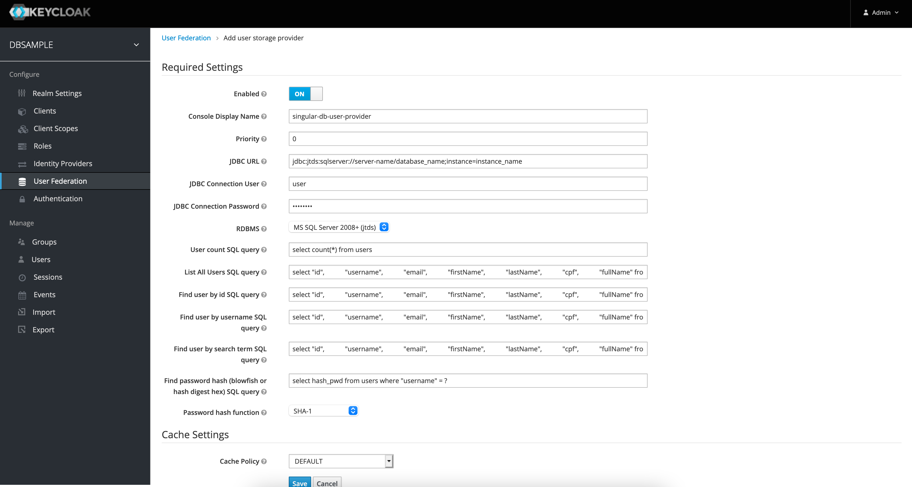
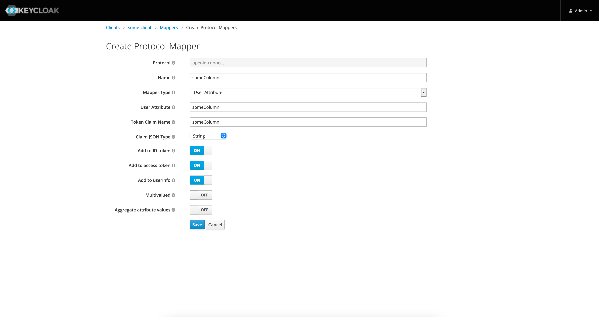

# singular-keycloak-database-federation

### Compatible with Keycloak 26+ quarkus based (built against Keycloak 26.8.0, requires Java 17+).
**For older versions look at older_versions branch.

Keycloak User Storage SPI for Relational Databases (Keycloak User Federation, supports postgresql, mysql, oracle and mysql).

- Keycloak User federation provider with SQL
- Keycloak User federation using existing database
- Keycloak  database user provider
- Keycloak MSSQL Database Integration 
- Keycloak SQL Server Database Integration 
- Keycloak Oracle Database Integration 
- Keycloak Postgres Database Integration 
- Keycloak blowfish bcrypt support

## Usage

    Fully compatible with Singular Studio NOCODE. See https://www.studio.opensingular.com/
    

## Configuration

Keycloak User Federation Screen Shot

There is a new configuration that allows keycloak to remove a user entry from its local database (this option has no effect on the source database). It can be useful when you need to reload user data.
This option can be configured by the following switch:

## Multi-realm usage

Use one User Federation provider instance per realm. Each realm should keep its own provider configuration, including JDBC URL, credentials, and SQL queries.

If multiple realms are backed by different databases or schemas, configure each realm with its own provider instance that points directly to that realm's data source. The plugin does not inject the Keycloak realm into your SQL queries automatically.

If you need multiple realms to share the same physical database, the configured SQL queries must enforce the right realm or tenant boundary themselves.

## Limitations

    - Do not allow user information update, including password update
    - Do not supports user roles our groups

## Custom attributes

Just add a mapper to client mappers with the same name as the returned column alias in your queries.Use mapper type "User Attribute". See the example below:
    

## Build

    - mvn clean package

## CI/CD release

The repository includes a GitHub Actions workflow in `.github/workflows/release.yml`.

- Pushes to `main` and pull requests run a Maven build and upload the `dist` artifacts as a workflow artifact.
- Pushes to `main` also create and push the next Git tag automatically using the Maven version from `pom.xml` as the `major.minor` base and incrementing the patch number.
- Pushing a tag named like `v2.3.1`, including tags created by the workflow, runs the release build and creates a GitHub release.
- The GitHub release uploads `dist/singular-user-storage-provider.ear`, which contains `singular-user-storage-provider.jar` at the EAR root, dependency JARs under `lib/`, and `META-INF/application.xml` configured with `library-directory` set to `lib`.

Example release command:

    git tag v2.3.1
    git push origin v2.3.1

## Deployment

    1) Copy every  `.jar` from dist/ folder  to  /providers folder under your keycloak installation root. 
        - i.e, on a default keycloak setup, copy all  `.jar` files to <keycloak_root_dir>/providers
    2) run :
        $ ./bin/kc.sh start-dev
    OR if you are using a production configuration:
        $ ./bin/kc.sh build
        $ ./bin/kc.sh start

## For futher information see:
    - https://github.com/keycloak/keycloak/issues/9833
    - https://www.keycloak.org/docs/latest/server_development/#packaging-and-deployment
    
    

